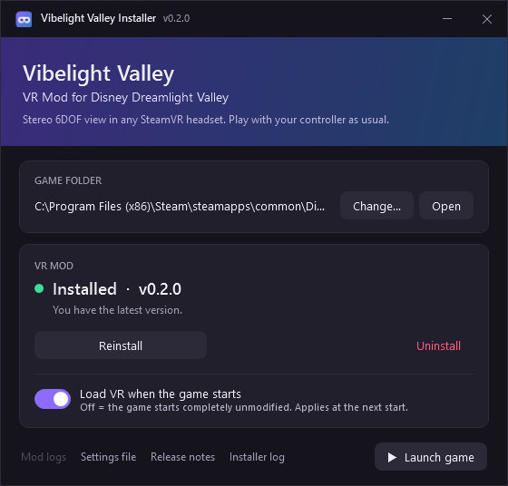

<p align="center"></p>

<h1 align="center">Vibelight Valley</h1>
<p align="center"><b>VR Mod for Disney Dreamlight Valley</b></p>

An unofficial VR mod for **Disney Dreamlight Valley** (PC/Steam). It shows the game in stereo 3D in a SteamVR
headset, with full 6DOF head tracking. You keep playing with a gamepad, or with VR controllers acting as one, and
your viewpoint hovers behind your character like the normal game camera does.

> **Status: experimental.** It's developed and tested on one setup: a Steam Frame with SteamVR, and an RTX 5080.
> Expect rough edges, and file issues with your log attached.
>
> **Disclaimer:** this is a fan project, not affiliated with Disney or Gameloft. Modding the game client is most
> likely against its terms of service. The mod only changes rendering, not gameplay, network traffic or the store,
> and the game has no anti-cheat. Use it at your own risk; playing solo is recommended.

**Contents:**
[Install](#install) · [Controls](#controls) · [Settings](#settings) · [Updating, turning off, uninstalling](#updating-turning-it-off-uninstalling) ·
[Troubleshooting](#troubleshooting) · [How it works](#how-it-works) · [Tools we used](#tools-we-used) ·
[Open-source projects](#open-source-projects-used-and-referenced) · [Building from source](#building-from-source)

## Features

- **Real stereo 3D**, rendered through the game's own graphics pipeline. Weather, lighting and the painterly look are
  kept.
- **6DOF head tracking**, anchored behind your character:
  - Lean in, look around and move your head freely.
  - The view follows the character without the game camera's up/down swings, which are bad for comfort.
  - Smoothed turning, and an optional vignette that darkens the edges of your view while turning.
- **HUD in VR:** interaction icons, the quest tracker, prompts and overlay menus float see-through in front of you.
- **Virtual screen** for the title screen, loading screens and full-screen menus.
- **Comfort and performance:**
  - Requests a fixed refresh rate (90 Hz by default), so the game frame rate matches the headset.
  - Adaptive resolution: busy scenes render at a lower internal resolution instead of dropping frames.
  - Recenters automatically when you put the headset on.
- **Safe and debuggable:**
  - If VR fails, the game keeps running flat and the log says why.
  - Detailed log: `BepInEx\VibelightValley\vibelight-valley.log`.
- **One-click installer** that installs, updates, switches the mod on and off, and uninstalls.

## Requirements

- Windows 10/11, Disney Dreamlight Valley on Steam (Direct3D 11, the default)
- SteamVR set as the active OpenXR runtime, with a PC VR headset
- A strong GPU: the game renders twice per frame at headset resolution

## Install

1. Download **[VibelightValley-Installer.exe](../../releases/latest/download/VibelightValley-Installer.exe)** and run
   it. It's a single portable exe, so keep it anywhere.
   - Windows may warn about an unrecognised app, because the exe isn't code-signed. Click *More info* → *Run anyway*.
2. Click **Install**. The installer:
   - finds the game in your Steam libraries (or use *Change…* to point it at `ddv.exe`)
   - downloads the mod and, unless it's already installed, the BepInEx mod loader
   - checks every download against the SHA-256 published with the release before writing anything
3. Set the game's display mode to **borderless/windowed** (exclusive fullscreen can break the headset image).
4. Start SteamVR, put the headset on, then press **Launch game** in the installer (or start the game from Steam).
   - The first start with BepInEx takes a minute or two while it prepares its files.

<p align="center"></p>

Upgrading from **DDLV-VR** (this project's old name)? Just run the new installer and click *Update*. It removes the
old copy and keeps your settings.

## Controls

| Input | Action |
|---|---|
| Click **both sticks** / **F4** | HUD layer on/off |
| **F5** / Num5 | Recenter (look straight ahead first) |
| **F8** | Show the game window as a floating screen |
| **F11** | VR rendering on/off |
| Num8 / Num2 | Viewpoint closer / farther |
| Num9 / Num3 | Viewpoint up / down |
| Num+ / Num- | World scale |
| PageUp / PageDown | Render resolution (`RenderScale` ±0.1, applies immediately) |
| **F2** | Adaptive resolution on/off |
| Num7 / Num1 | HUD up / down |
| F6 / F7 | Flip eye images / virtual screen (only if something is upside down) |
| Ctrl+F2 | Fast eye submit on/off (switch off if the world is upside down) |
| F3 | Diagnostics: switch the game's render effects off in the headset one at a time |
| Ctrl+F3 | Diagnostics: performance benchmark (see [Performance](#performance)) |
| F9 / F10 / F12 | Diagnostics: scene dump / PNG dump / test pattern |

Keyboard keys need the game window to be focused.

## Settings

Edit `<game>\BepInEx\config\vibelight.valley.cfg`. The installer's *Settings file* link opens it. It's created on
the first start, and every entry is documented in the file. The most useful ones:

| Section | Setting | Default | |
|---|---|---|---|
| Rendering | `RenderScale` | 1.0 | Multiplier on SteamVR's recommended per-eye resolution: the sharpest the eyes get. Also check SteamVR's *per-application* resolution for the game, which overrides the global slider |
| Rendering | `AdaptiveResolution` | true | Lowers the eyes' internal resolution while the GPU can't keep up, and raises it again when it can |
| Rendering | `AdaptiveMinScale` | 0.6 | The lowest adaptive resolution may go, as a fraction of `RenderScale` |
| Rendering | `FastEyeSubmit` | true | SteamVR turns the eye images the right way up, instead of an extra full-screen copy per eye |
| Rendering | `RefreshRate` | 90 | Headset refresh rate to request; 0 = leave SteamVR's setting |
| Rendering | `DesktopView` | Mirror | Desktop window while in VR: `Mirror` (left eye + UI) or `Minimal` (UI only) skip the game's own world render; `Full` = normal view (slower) |
| Rendering | `EyeShadowDistance` | 40 | Shadow distance in the headset (game: 80); shorter = faster in busy scenes |
| Rendering | `EyeShadows` | true | Shadows in the headset (each eye renders its own; `false` helps a lot in busy scenes) |
| Rendering | `EyeDrawDistance` | 0 | Far clip for the eyes in metres (0 = game default); lower = faster |
| Comfort | `FollowMode` | Character | `Character` = fixed spot behind your character; `GameCamera` = ride the game camera |
| Comfort | `FollowDistance` / `FollowHeight` | 6 / 3 | Character mode viewpoint |
| Comfort | `TurnSmoothing` | 0.5 | Seconds to follow camera turns (0 = instant) |
| Comfort | `Vignette` | 0.7 | Edge darkening while turning (0 = off) |
| HUD | `Enabled` | true | Show the game UI in VR |
| HUD | `Placement` | View | `View` = stays in front of you; `GameCamera` = exactly in the game camera's view (icons line up, but it swings with the camera) |

## Performance

VR has to deliver a new frame for every headset refresh (8.3 ms at 120 Hz, 11.1 ms at 90 Hz), and the game renders
the world twice per frame, once per eye.
- **Adaptive resolution** (on by default) keeps the GPU inside that budget. When a scene gets busy, the eyes render
  at a lower internal resolution and are scaled up. When there's headroom again, the resolution climbs back to
  `RenderScale`. So set `RenderScale` (PageUp/PageDown) to the sharpness you want and let adaptive resolution handle
  busy scenes. F2 switches it off for a comparison.
- **Refresh rate:** the game's own logic needs several milliseconds per frame. If the frame rate stays below 120 even
  at a low resolution, set the headset to 90 Hz in SteamVR (*Settings → Video*). The mod can't change it on headsets
  that only offer one rate to OpenXR.
- **Benchmark:** stand still facing a busy spot and press **Ctrl+F3**. For about 40 seconds the mod switches one thing
  off at a time and measures the difference: lower resolution, shadows, the LOD boost, each of the game's render
  effects, and the HUD. The results go to the log as a `BENCH results` table, with the biggest savings summarised in
  a `BENCH done` line.
- **The log's `PERF` lines** (every 5 s) show where each frame's time goes: `logic` (the game), `render(cpu)`,
  `gpu`, and `scale`, the current adaptive resolution.

## Updating, turning it off, uninstalling

Everything goes through the installer:
- **Update:** open the installer. It checks GitHub for a new release every time it starts, and shows
  **Update to vX** when there is one. It also updates itself.
- **Turn off:** switch off **Load VR when the game starts**.
  - "Off" stops the mod loader from loading at all, so the game starts completely unmodified.
  - Switch it back on any time.
- **Uninstall:** click **Uninstall** (with the game closed).
  - It removes the mod, its settings and its logs.
  - It also removes BepInEx, unless other BepInEx mods use it.
  - Afterwards you can run Steam → *Verify integrity of game files* to be sure everything is original.

**From a script:**
```
VibelightValley-Installer.exe on|off|toggle|status|install|uninstall [--game-dir "D:\Games\Disney Dreamlight Valley"]
```
- `status` prints `on`/`off`.
- Exit codes: 0 = on/ok, 1 = off, 2 = error or not installed.

## Troubleshooting

Logs (the installer's *Mod logs* and *Installer log* links open them):
- `<game>\BepInEx\VibelightValley\vibelight-valley.log` (main log; the previous run is `vibelight-valley.prev.log`)
- `<game>\BepInEx\LogOutput.log` (BepInEx)
- `%USERPROFILE%\AppData\LocalLow\Gameloft\Disney Dreamlight Valley\Player.log` (the game)
- `%LOCALAPPDATA%\VibelightValley-Installer\installer.log` (installer)

Common problems:
- **"xrCreateInstance failed: ErrorRuntimeFailure"** — the headset is not connected or SteamVR is not ready. The mod
  retries every 10 s.
- **Game seems stuck when launched from inside VR** — Steam may be showing a dialog on the desktop monitor.
- **View faces the wrong way** — press F5 or recenter from the SteamVR menu.
- **Upside-down image or wrong colours** — press F12 for the test pattern: the top half should be green, with a
  white square top-left in the left eye. F6 flips the eye images.

## How it works

Disney Dreamlight Valley has no VR support of its own. Vibelight Valley adds it from the outside, without changing
any game files. Here's the whole chain, from double-clicking the game to an image in your headset.

### 1. Getting code into the game: BepInEx

The game is built with **Unity 6**, using Unity's *IL2CPP* option. All the game's C# code has been converted to
native machine code (`GameAssembly.dll`), so there are no normal .NET assemblies to load a mod into.

[BepInEx](https://github.com/BepInEx/BepInEx) is the standard mod loader for this situation:
- **Getting in:** BepInEx drops a small `winhttp.dll` into the game folder. Windows loads it when the game starts
  (the [Doorstop](https://github.com/NeighTools/UnityDoorstop) trick). It starts a .NET runtime inside the game and
  loads mods from `BepInEx\plugins`.
- **Talking to the game:** on the first start, BepInEx generates *interop assemblies*, a C# view of the game's
  classes, using [Il2CppInterop](https://github.com/BepInEx/Il2CppInterop). Through these the mod can use Unity
  objects (cameras, canvases, textures) as if it were part of the game.
- **On/off switch:** the installer's switch flips `enabled` in `doorstop_config.ini`. "Off" means nothing is
  loaded at all.

### 2. Talking to the headset: OpenXR

[OpenXR](https://www.khronos.org/openxr/) is the industry-standard API between VR apps and VR runtimes such as
SteamVR.
- **Its own session:** the mod ships the official Khronos `openxr_loader.dll`, calls it directly from C#, and runs
  its own OpenXR session. Unity's built-in VR support is compiled out of this game, so it can't be used.
- **Sharing the game's GPU:** it connects that session to the Direct3D 11 device the game already renders with
  (`XR_KHR_D3D11_enable`), so images can be handed to SteamVR without copying them through the CPU.
- **Optional extras**, used when the runtime supports them:
  - `XR_EXT_user_presence`: recenter when you put the headset on
  - `XR_FB_display_refresh_rate`: request a fixed refresh rate
  - `XR_EXT_view_configuration_views_change`: follow resolution changes live

### 3. Drawing each frame twice: the eye cameras

A VR frame needs two images, one per eye, from slightly different positions. Every frame:

1. **Wait for the headset.** The mod asks OpenXR when the next image will be shown and where your head will be at
   that moment (`xrWaitFrame` / `xrLocateViews`). This also paces the game to the headset's refresh rate.
2. **Place two hidden cameras.**
   - The mod creates two extra Unity cameras that copy the game camera's settings (render pipeline, post-processing,
     shadows).
   - They sit at a spot behind your character, with your real head movement added on top.
   - Each eye camera then gets its own position and field of view from the headset.
3. **Render through the game's own pipeline.**
   - Unity's Universal Render Pipeline (URP) draws each eye exactly like the normal game view, effects included.
   - A few effects assume a normal flat screen. For example, the sky shader expects a symmetric view. The eye
     cameras are adjusted so those effects look identical in both eyes.
4. **Hand the images to SteamVR.**
   - Graphics work must happen on Unity's *render thread*, so the mod hooks into it with
     `GL.IssuePluginEvent`.
   - There it copies each eye image into an OpenXR swapchain (`CopyResource`) and submits the frame
     (`xrEndFrame`).

To stay fast, the normal game camera is told to draw nothing while VR is on. The desktop window shows a copy of the
left eye instead. Shadows and level-of-detail are tuned only for the eye cameras.

### 4. The HUD and menus: layers

Games draw their HUD as an overlay on the flat screen, which a VR headset doesn't have. The mod solves this in
three parts:
- **HUD layer:**
  - The game's overlay canvases are moved onto a private camera that renders only the UI, onto a transparent
    texture.
  - That texture is sent to SteamVR as a separate see-through *quad layer*, floating in front of you.
  - It keeps the exact screen coordinates, so icons still line up with world objects.
- **Virtual screen:** for full-screen menus, loading screens and the title screen, a capture of the game window
  floats in front of you like a big monitor.
- **Vignette:** another quad layer, which darkens the edges of your view while the view turns.

SteamVR combines these layers. It does the final lens distortion and reprojection, which keeps things smooth even
when a frame is late.

### 5. Comfort

- **Viewpoint:** in *Character* mode the viewpoint stays at a fixed distance and height behind your character, and
  ignores the game camera's up/down motion.
- **Turning:** turns are smoothed.
- **HUD:** stays at a fixed tilt in front of you.

These are the settings that matter most for avoiding motion sickness.

### 6. The installer

`VibelightValley-Installer.exe` is a small Windows app. It's written in C# with WPF on .NET Framework 4.8, which
comes with Windows.
- **Checking for updates:** every GitHub release includes a `manifest.json` with:
  - the latest version
  - download links for the mod, BepInEx and the installer itself
  - the SHA-256 of each download

  The installer reads it from `releases/latest`, so new releases reach users the next time they open it.
- **Installing:** it puts the mod in `BepInEx\plugins\VibelightValley`. It installs BepInEx only if it's missing,
  and notes the installed version in `install.json`.
- **Uninstalling:** it removes exactly what it added.

### Code map

| Folder | What's in it |
|---|---|
| [src/VibelightValley/Xr](src/VibelightValley/Xr) | OpenXR: loader calls, session, swapchains, quad layers, math |
| [src/VibelightValley/Gfx](src/VibelightValley/Gfx) | Direct3D 11 access and the render-thread callback |
| [src/VibelightValley/Vr](src/VibelightValley/Vr) | The VR rig: eye cameras, HUD layer, frame composition, comfort, controls |
| [src/VibelightValley/Diagnostics](src/VibelightValley/Diagnostics) | Logging, startup report, frame profiler, dumps |
| [src/VibelightValley/Core](src/VibelightValley/Core) | Settings, log file, hotkeys |
| [src/Installer](src/Installer) | The installer app |
| [tools](tools) | Build, package and release scripts |
| [docs/PLAN.md](docs/PLAN.md) | The original research and design plan |

## Tools we used

| Tool | Used for |
|---|---|
| [Claude Code](https://claude.com/claude-code) (Anthropic) | The mod was designed, written and debugged in Claude Code sessions, with playtesting in the headset in between |
| [.NET SDK 8](https://dotnet.microsoft.com/) and C# | Compiling the mod (.NET 6 target, which BepInEx runs on) and the installer (.NET Framework 4.8) |
| [BepInEx](https://github.com/BepInEx/BepInEx) 6.0.0-be.788 (Unity IL2CPP) | Loading the mod into the game and generating the interop assemblies |
| [Khronos OpenXR SDK](https://github.com/KhronosGroup/OpenXR-SDK-Source) 1.1.63 | `openxr_loader.dll`, plus the OpenXR specification for the API calls |
| [SteamVR](https://store.steampowered.com/app/250820/SteamVR/) | The OpenXR runtime used for testing (Steam Frame headset) |
| Windows PowerShell | Build, package, release and test scripts in [tools](tools) |
| [Git](https://git-scm.com/) (PortableGit) and [GitHub CLI](https://cli.github.com/) | Version control and publishing |
| [GitHub Actions](https://github.com/features/actions) | Automatic releases on every push to `main` |

## Open-source projects used and referenced

**Shipped or downloaded by the mod/installer:**
- [Khronos OpenXR SDK](https://github.com/KhronosGroup/OpenXR-SDK-Source): `openxr_loader.dll` ships with the mod (Apache-2.0).
- [BepInEx](https://github.com/BepInEx/BepInEx): the installer downloads it from [builds.bepinex.dev](https://builds.bepinex.dev/projects/bepinex_be) (LGPL-2.1).
  It includes:
  - [Il2CppInterop](https://github.com/BepInEx/Il2CppInterop) (LGPL-3.0)
  - [HarmonyX](https://github.com/BepInEx/HarmonyX) (MIT): used for one diagnostic hook that logs why the game quits
  - [UnityDoorstop](https://github.com/NeighTools/UnityDoorstop) (LGPL-2.1)

**Design references (studied, no code copied):**
- [ConSimVR](https://github.com/nick10180/ConSimVR): a VR mod for another IL2CPP Unity game. It showed that a C#
  OpenXR session with render-thread submission works on D3D11 + BepInEx 6, and taught the frame-pairing rules
  that keep the headset from freezing.
- [UnityVRMod](https://github.com/NewUnityModder/UnityVRMod): a generic Unity VR injector, used as a reference for
  OpenXR from C#, eye cameras and the projection math.
- [CircuitLordVRModInstaller](https://github.com/CircuitLord/CircuitLordVRModInstaller): the installer for the
  Titanfall 2 and Big Walk VR mods. It inspired our installer's design: one portable exe, a release manifest with
  pinned hashes, and self-update.

**Release automation:**
- [ietf-tools/semver-action](https://github.com/ietf-tools/semver-action): works out the next version from commit
  messages
- [actions/checkout](https://github.com/actions/checkout) and [actions/setup-dotnet](https://github.com/actions/setup-dotnet)
- [Conventional Commits](https://www.conventionalcommits.org/): the commit-message convention the version bump is
  based on

Full license details: [THIRD_PARTY_NOTICES.md](THIRD_PARTY_NOTICES.md).

## Building from source

1. Install the mod once (or just BepInEx) and start the game once: BepInEx generates the interop assemblies in
   `<game>\BepInEx\interop` that the project compiles against. They come from your own game copy and are never
   committed.
2. Run:
   ```
   powershell -ExecutionPolicy Bypass -File tools\fetch-deps.ps1
   powershell -ExecutionPolicy Bypass -File tools\build.ps1
   ```
   - `fetch-deps` downloads the OpenXR loader into `lib\native` and a local .NET 8 SDK into `.tools`.
   - `build` compiles and deploys into the game (`-NoDeploy` to only build, `-GameDir` for another location).
   - It also updates `release/plugin/` (the DLL plus a hash of the source it was built from).
3. `tools\package.ps1` builds the release files in `dist\`: `VibelightValley-Installer.exe`,
   `VibelightValley-x.y.z.zip` and `manifest.json`.
   - **Test a release before publishing:**
     1. Run `tools\package.ps1 -NoBuild -LocalManifest`.
     2. Set `VIBELIGHT_MANIFEST=<repo>\dist\manifest.json`.
     3. Start `dist\VibelightValley-Installer.exe`. It installs from `dist\` instead of GitHub.

### Releasing

Every push to `main` publishes a GitHub release through [.github/workflows/release.yml](.github/workflows/release.yml).
- **The DLL:** GitHub's runners can't compile the mod, because there are no game interop assemblies there. So
  **commit `release/plugin/` together with your source changes**, after running `tools\build.ps1`. The workflow
  refuses to release if the source changed after the DLL was built.
- **The version** comes from [Conventional Commits](https://www.conventionalcommits.org/) since the last tag:
  - `feat: ...` gives a minor release
  - `fix: ...` / `perf: ...` / anything else gives a patch release
  - `BREAKING CHANGE` in the commit body gives a major release
- **What gets published:**
  - the installer exe
  - the mod zip
  - `manifest.json`, with the version, download URLs and SHA-256 hashes

## License

[MIT](LICENSE). Third-party components are listed in [THIRD_PARTY_NOTICES.md](THIRD_PARTY_NOTICES.md).
Disney Dreamlight Valley is a trademark of its respective owners.
